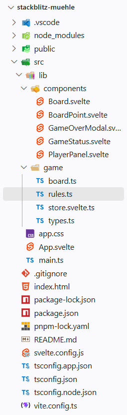

# Seiwald-Mitschrift

Das ist die Readme.md-Datei. MD steht für Markdown. Markdown ist eine heutzutage weit verbreitete Auszeichnungsprache (_Markup Language_, [Wikipedia](https://en.wikipedia.org/wiki/Markdown)).

Weiter bekannte
Auszeichnungssprache sind:

- Hypertext Markup Language (HTML)
- Extensible Markup Language (XML)
- Yet Another Markup Language (YAML, XMI)

# Installation node.JS

Javascript läuft unter normalen Umständen in einer Browser-Sandbox (nur im Browser). Seit ca. 2010 gibt es Laufzeitumgebung (_Runtime Environment_) für JS, damit man auch serverseitig JS programmieren und ausführen kann: [Node.js](https://nodejs.org/en).

## Installation von pnpm

Der standardmäßige _Package Manager_ für Node.js ist npm (_Node Package Manager_). Eine etwas modernere und inzwischen beliebtere alternative ist [Pnpm](pnpm.io)

## Installation von strapi

Installation mit dem Skript `pnpm create strapi` Daraufhin führt das CLI durch die Installation. Falls bei der Installation sogennante build scripts nicht eingeführt werden können schlägt die CLI die Fehlerbehandlung selbständig vor.

1. Wechseln in das Installationsverzeichnis (z.B. mit `cd strapi-project`)
2. Führe den Befehl `pnpm install` aus, um die fehlenden Pakete zu installieren und die uild-Skripte auszuführen. Dieser scheitert in der Regel - die Build Skripte müssen mit pnpm approve-builds manuell freigegebn werden.

---

# Historische Entwicklung von WebDev

Webdevelopement hat im Laufe der letzten rund 35 Jahre Evolutionsstufen druchlaufen:

1. Statische Webseiten (HTML, CSS, JavaScript) - initale Phase des Webdevelopments, bei der die Webseiteninhalte fest im HTML-Code verankert waren. Dominant in den 1990er Jahren.

2. Dynamische Webseiten (mit serverseitiger Programmiersprache - PHP, Python, Ruby, Java, C# und Datenbankanbindung) - Webseiteninhalte werden dynamisch generiert. Dominant in den 2000er Jahren.

3. Single Page Applications (SPA) - mit JavaScript-Frameworks (z.B.: React, Vue.js, Angular) erstellte "Webapps", die ähnliche Funktionalität wie Desktop-Apps bzw. Mobile Apps bieten. Dominant in den 2010er Jahren. Um Handy-Apps möglichst nahe zu kommen, wurden die SPA-Frameworks um _Progressive Web Apps_ (PWA) erweitert. Damit können die Webapps auch offline genutzt werden. Es gibt drei Voraussetzungen für PWAs:
   1. Service Worker, ein Service Worker ist eine Javascript Datei, die im Hintergrund des Browsers läuft - selbst wenn der Browser geschlossen ist,
   2. Manifest-Datei,
   3. HTTPS, die Webapp muss über HTTPS zugänglich sein.

   Frontend-Frameworks wenden folgende Architekturprinzipien an, um eine möglichst gute _User Experience_ (UX) zu erreichen:
   - **Komponenten** - Komponenten sind die wiederverwendbaren "Lego"-Bausteine einer Webapp. Sie kapseln HTML, CSS und JavaScript in einer einzigen Einheit, die unabhängig von anderen Komponenten entwickkelt, getestet und gewartet werden kann.
   - **Deklarative Programmierung** - der Javascript- und Template(HTML)Code beschreiben, wie die Benutzeroberfläche aussehen soll, anstatt wie sie aufgebaut werden soll. Das Framework kümmert sich um die Umsetzung. Dabei kommt **Reaktivität** ins Spiel. Wenn sich die Daten ändern, wird die Benutzeroberfläche (UI) automatisch aktualisiert. Wenn die Aktualisierung auch in die andere Richtung funktioniert, (d.h. wenn sich die Benutzeroberfläche ändert, weil der mit ihr interagiert, und der Zustand (_State_) der Anwendung sich entsprechend ändert), spricht man von bidirektionaler Reaktivität (_Two-Way Data Binding_). Logikelemente (Schleifen zur Darstellung von Liste und Bedingungen für das konditionale Ein- und Ausblenden von UI-Elementen) werden in den Templates von Frameworks in die eigentliche Benutzeroberfläche übersetzt. Komponenten können auch andere Komponenten enthalten, die als _Child Components_ bezeichnet werden. Die übergeordnete Komponente wird als _Parent Component_ bezeichnet. Komponenten können auch _Props_ (Eigenschaften) an ihre untergeordneten Komponenten weitergeben, um die Wiederverwendbarkeit und Flexibilität zu erhöhen.

# Vibecoding / AgenticEngineering mit VS-Code und Github Copilot

Vibecoding passiert in VS-Code in erster Linie über die neu eingeführte Agent View. Dort können alle Anpassungen des "_Coding Harness_" vorgenommen werden. Wir können unseren _Harness_ mit verschiedenen Methoden anpassen.:

- **MCP-Server**:
  MCP steht für _Model Context Protocoll_. Es ist ein Standard, der von Anthropic entwickelt wurde. Mit Hilfe von MCP können Chatbots/LLMs (_Large Language Model_) auf zusätzliche Tools zugreifen, die sie zu Experten in einem bestimmten Themenbereich machen.

  ***

  # Frontend-Entwicklung

  ## Ordnerstruktur

  Die Ordnerstruktur einer typischen Frontend-Anwendung sieht in etwa so aus:

  

  Der Ordner .vscode enthält Einstellungen für den VS-Codee-Editor. Der Ordner node*modules enthält die Abhängigkeiten oder auch Dependencies der Anwendung. Das sind jene Pakete, die bei der Entwicklung (\_build time*) und/oder bei der Ausführung (_run time_) benötigt werden. Alle Abhängigkeiten sind in der Datei `package.json` aufgelistet. Außerdem enthält die Datei `package.json` Metadaten über die Anwendung, wie z.B. Name, Version, Autor, Lizenz und Skripte für die Entwicklung und den Betrieb der Anwendung.

  Der Ordner Public enthält die statischen Dateien der Anwendung, wie z.B. HTML-Dateien, CSS-Dateien, Bilder und andere Ressourcen die direkt vom Browser geladen werden können.

  Der Ordner `src` enthält den Quellcode der Anwendung. Die Dateien `app.css`
  und `app.js` und `main.ts` sind die Einstiegspunkte der Anwendung (In diesem Fall eine SPA). Sie werden vom Browser als erstes geladen, wenn die entsprechende Website aufgerufen wird. Die Datei `app.css` enthält die globalen CSS-Stile der Anwendung. Die Datei `app.js` enthält den JavaScript-Code, der die Anwendung initialisiert und startet. Die Datei `main.ts` ist die Hauptdatei der Anwendung, die die Komponenten importiert und zusammenfügt.
